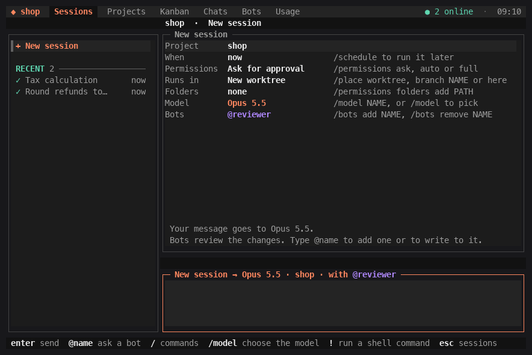

# ELU

A full-screen terminal app that runs coding sessions on the AI command lines you already
use, with bots that review and do work, and teammates you can ask.



## Install

From your home folder, not inside a project you do not trust:

```sh
npx -y @elu-labs/elu
```

This opens ELU and installs the `elu` command; next time you type `elu`. To install
a given version, name it: `npx -y @elu-labs/elu@0.1.12`.

You need macOS or Linux, Node 22 or newer, Git, Claude Code signed in, and Codex installed
(no sign-in needed; its sandbox runs your project's checks):
`npm install --global @openai/codex`. Using Antigravity? Read
[its page](docs/vendors/antigravity.md) first. More in [Install details](#install-details).

## Start

```sh
elu
```

The first start asks for a project name; later starts open your last project. Type a
message and press Enter. That starts a session: the model answers, or edits in a new Git
worktree on its own branch. Then the project's checks run and `@reviewer` reviews the
change. Nothing is pushed until you type `/publish` and confirm.

What installing, building and testing leave in the worktree is not a change when Git ignores
the folder itself: `node_modules`, `vendor`, `.venv`, `venv`, `__pycache__`, `*.egg-info`,
`.eggs`, `.next`, `dist`, `build`, `coverage`, `htmlcov`, `.pytest_cache`, `.hypothesis`,
`.turbo`, `.cache`, `target` and the like, and an ignored `.coverage` file. Nothing in those
folders is read, so a link or a large file there never stops a session, and none of it is
published. A folder of one of those names that Git does not ignore, such as a tracked
`src/build`, is an ordinary folder. Any other ignored file the model writes fails the
`no-ignored-output` check, and one that looks like a secret, such as `.env` or
`src/build/.env`, fails `secret-paths`; a link among them is never followed.

A worktree sits beside its repository, in a folder named after it with `.elu-code` added
(`shop.elu-code` beside `shop`). When a Task edits the project folder itself and the folder
has no commits yet, ELU first commits its files there as `Start project history`,
running `git init` if it needs to, and pushes nothing. A file that looks like a secret, such
as `.env`, stops it until `.gitignore` keeps that file out.

| Tab | What it shows |
| --- | --- |
| Sessions | Every session across your projects. The selected one is open beside the list. |
| Projects | Your projects. `n` makes one, `o` makes another the active one. |
| Kanban | The open project's tasks and sessions: To do, In progress, Needs you, Done. On a team, everyone with a clone of the same repository shares one board: every session a teammate, or another computer of yours, runs in it shows in the same columns with who started it and on which machine, to read only. A project whose folder holds several repositories has a board for each. `/share off` keeps a project off it both ways. |
| Chats | Your team's channels, your teammates and your bots. |
| Bots | Your bots. `n` makes one, Enter opens one. |
| Usage | Your vendor accounts and their plan usage, then your top 10 agents by cost with their tokens. `t` switches between today and the last 7 days. |

Click a tab's name. Or press Tab until the tab row is selected, choose with ← and →, and
press Enter.

## Tasks

Ask for a change to code or files, or for work that needs planning, and the first reply is
a Task: a title, a description, the goal, the objectives that say when it is done, a
priority, a severity, the success criteria that show it is done, and the model's estimate
of the work. Nothing is edited yet.

| Do | What happens |
| --- | --- |
| Esc, then `y` | Approves the Task. The work starts by itself. |
| Esc, then `n` | Rejects it. Nothing is changed. |
| Type a message | Changes the Task. The card shows the new revision. |

Typing `yes` and Enter approves too. A question gets a plain answer and no Task. A follow-up
inside an approved Task's goal starts at once; a new piece of work gets a Task of its own.
An approved Task gives its session its name, unless you named the session yourself.

On the Kanban tab a session with a Task shows as that Task: its title, how far it is, its
priority and its severity. One that waits for your approval is under Needs you. Enter opens
the whole Task, as does a click: the goal, the objectives, the success criteria, the subtasks
and the ETA. Its Go to session button opens its session; Enter presses it. A teammate's card,
and one of your other computer's, open the same way.

After you approve, the model splits the work into subtasks and changes them as it likes.
The card lists them as a checklist and marks the objectives the model reports met. Its ETA
is approval plus the estimate, and follows the minutes left the model reports as it works. The
Task is done when every objective is reported met and the turn, with its checks and
review, has ended. A new message opens it again.

ELU starts the edit only for a Task you approved. What the model can still do in its
first turn depends on the vendor and the mode:
[docs/permissions.md](docs/permissions.md#plan-first).

## Commands

Type these in the message box. `/` alone lists every command, and `/help` explains the keys.

You can send a message at any time. One sent while the session is working waits in the chat and is sent by itself when that turn ends; several go together, in order. `↑` in the empty message box takes the newest one back so you can change it.

| Type | What it does |
| --- | --- |
| `/new` | Starts a new session |
| `/model sonnet` | Chooses the model of this session; `/model` alone lists them |
| `/permissions auto` | Sets what the model may do: `ask`, `auto` or `full` |
| `/place branch try-coupons` | Sets where a new session runs: `worktree`, `branch NAME` or `here` |
| `/bots add qa` | Keeps a bot in this session; `/bots remove qa` takes it out |
| `/agent add fable` | Adds another model to this session as an agent; write `@fable` and what to do. Words after the model say what it is for, and `--name NAME` names it: `/agent add sonnet you review my SQL --name sql` |
| `@pair is there a simpler way?` | Asks a bot. Your next messages in that session go to it too |
| `@model and what do you think?` | Writes to the session's model again |
| `/changes` | Shows what this session changed; `/chat` goes back |
| `/publish` | Shows the exact push and draft pull request, then asks you |
| `/stop` | Stops the running response. A message you sent while it ran is sent next; `/stop` again cancels that message |
| `/schedule in 1h check the build` | Starts a session later or on a schedule: `/schedule [when] [message]`. `/schedule ` lists times such as `in 5m`, `in 1h` and `daily 9:00`. Each run is a new session with the model, mode and bots of the form (a bot with its own schedule is left out); it does not see the chat it was made in. A schedule gets Full access only when you pick it for that schedule, and the form asks you once before saving it |
| `/budget 5` | Limits this session to 5 dollars; `/budget off` removes the limit |
| `/standup` | Asks every open session of yours, here and on your other computers, and your teammates' shared ones, for an update, in a new Standup session. See [Standup](#standup) |
| `@everyone did anyone touch auth?` | In a Standup session, asks the sessions of its last round again, with your question; `@everyone standup` asks for an update. Elsewhere it starts a Standup with the question |
| `! git status` | Runs a shell command. In an open session the model gets the command and its output with your next message |
| `/update` | Says how to update: `/quit`, then `elu update` |
| `/quit` | Closes ELU. Sessions that are running or queued go on in the background; `elu conductor stop` stops them |

A schedule also runs while ELU is closed, through a login item, once ELU is
installed (not run through `npx`). On macOS, while an agent works or a schedule is on, ELU
stops the Mac from going to sleep on its own (`caffeinate -i`); the display can still
sleep. Schedules show in the Sessions tab under Scheduled: `p` pauses one and `x` deletes
it. A time is `in 30m`, `every 2h` (15 minutes to 7 days), `daily 9:00`, `weekdays 9am`,
`mon,thu 14:30`, `tomorrow 15:00` or `2026-12-01 9:00`, in this computer's local time.
The model cannot make a schedule itself: asked to repeat work, it gives you the
`/schedule` line to type.

## Permissions

Each session runs in one of three modes. `/permissions ask`, `auto` or `full` changes it,
and `/permissions default auto` sets what new sessions start with.

- **Ask for approval** (`ask`, the default): edits the session's files and asks you before
  anything else, the internet included.
  Codex cannot ask you during a turn, so there these are refused and reported.
- **Approve for me** (`auto`): edits the session's files; a reviewer model, not you, decides
  the rest. Commands get no internet unless the reviewer lets one leave the sandbox.
  On Grok Build, what its reviewer refuses then asks you.
- **Full access** (`full`): any file, any command, the internet, with no sandbox. That
  includes push, tags, merges, publishing and deploys: the never list below does not apply.

When the model asks, `y` allows and `n` denies; `f` allows and gives that session Full access.
`a` allows and keeps a narrow rule, such as `npm test` or `git diff`, for this project or all
of them, so it is not asked again. Reads in the project, git reads and the project's own test,
lint and build scripts run without asking from the start. `/permissions rules` or
`elu permissions` lists them all and removes any. No rule covers the never list.
You can change the mode while a turn runs. When a turn stopped on something a wider mode
allows, its Blocked line says which, and raising the mode continues the turn at once, with
only what that mode allows. A turn that also stopped on your no, or on the never list, waits
for your reply.
A new approval rings the terminal bell once.

Bots that review, and a teammate's question, always run read only.
`/permissions folders add <path>` lets the model read one more folder of your home this
session.

On Claude Code, your own MCP servers (`claude mcp list`) are on for the model and for bots
that work, and their tools run without asking in every mode. Neither the sandbox nor the
never list below covers them, so a server can reach the internet and act on other services.
`/mcp off NAME` turns one off for the project. A teammate's question never gets them.

`/mcp add` adds a server: it asks for a name, the URL (or the command that starts it), the
header that carries its key, such as `Authorization`, and then the key, in a field that
shows only dots. Claude Code saves it for every folder (`claude mcp add-json --scope user`),
and sessions get it from their next turn. `/mcp remove NAME` removes one after asking. From
a shell, `elu mcp add NAME URL --header Authorization` asks for the key with echo off, or
reads it from standard input; a command goes after `--`, as in
`elu mcp add github --env GITHUB_TOKEN -- docker run -i --rm ghcr.io/github/github-mcp-server`.
`elu mcp remove NAME` removes one. If you paste a server config, such as an `mcpServers`
block, or a `claude mcp add` line (with `!` or without) into the message box, ELU does
not send or run it: it offers to add the server, so the key stays out of the chat. The model
is told to ask you to type `/mcp add` when it needs a server you do not have, and adding or
removing one is on the never list, outside Full access.

ELU does not push, merge, tag, deploy or publish by itself. `/publish` shows the exact
push and the draft pull request, waits for you, and refuses a default branch. Outside Full
access the model is told never to run those commands, and on Claude Code they are denied by
rule. Stand-in commands, first on the PATH of every session in Ask for approval or Approve
for me, also refuse them by name, inside a script too; a full path to the real command gets
past those. One exception: a bot that is allowed to merge pull requests may run
`gh pr merge`. Ask for approval still asks you first; in Approve for me the reviewer model
decides. `@elu` comes allowed; a bot you make is not. In Full access none of this applies:
the model, and a bot working in that session, may push, open and merge pull requests, tag,
publish and deploy when the task calls for it.
Details:
[docs/permissions.md](docs/permissions.md), [SECURITY.md](SECURITY.md).

## Bots

A bot is a model with a name and instructions. You write it once and use it in any session.
In a session a bot reviews each change, answers when you write `@name`, or does work of its
own.

Five come with the app. You can edit or remove any of them in the Bots tab.

| Bot | Runs on | What it does |
| --- | --- | --- |
| `@reviewer` | Claude, Opus | Reviews every change for correctness, security, performance and maintainability |
| `@lead` | Claude, Fable, with Opus helpers | When you write to it: plans the work, hands the pieces to helpers, and checks what they return |
| `@qa` | Claude, Opus | When you write to it: tests the change like a user, fixes what it finds, and verifies each fix |
| `@pair` | Codex, `gpt-6.1-sol`, high effort | A second model beside the working agent: says what it would challenge after each turn, and reviews each change |
| `@elu` | Claude, every hour | Finds issues in your live product with [ELU](https://elu.dev), then reviews and merges the fix pull request or writes the fix |

- A new session starts with `@reviewer`. `/bots add qa` adds another bot, and so does `@qa`
  alone and then Enter.
- `@lead plan the refund change` gives a bot work. `@lead`, `@qa`, `@elu` and each bot you
  make do the work you write to them, within the session's permissions; `@reviewer` and
  `@pair` read and answer.
- After each edit, ELU runs the checks and every reviewing bot of the session reviews
  the change. Its must-fix findings go to the model, which fixes each one or disputes it with
  a reason; then the checks and the review run again, up to the policy's review rounds. The
  chat shows each step, such as `@reviewer: 2 must-fix`, `Fixed 2` and `@reviewer: Passed.`
  The model is told which bots review its change and that ELU runs the checks and
  publishing, so it never asks you to wait for a bot, review, commit, push or merge.
- Write to a reviewing bot about edits the session has not published, such as `@reviewer make
  sure the fixes are real, not nitpicks`, and it reviews them with your words, in that same
  loop. That holds when the session's own editing turn finished, it changed files and stopped
  after that (ready, blocked, not verified or waiting for you), and the bot is one of its
  reviewers. Edits you had in your checkout before the session started are not its own. The
  fixes are work on the session's approved Task: a Task that was done opens again for them
  and closes again when the review passes. The bot's must-fix findings stay within that Task;
  new work is at most a suggestion, and you ask the agent for it. A message that starts with
  `?`, or ends with `?` and asks for no work (fix, check, review, verify, work with or on, go
  through, look at, make sure), is a question: the bot answers it in the chat.
- After you write to a bot, your next messages in that session go to it too, until you name
  another bot or start a message with `@model`. The title of the message box names who gets
  the message. A bot you stop picks up where it stopped on your next message when it runs on
  Claude Code or Grok Build; on the others its next turn starts from the chat. When it
  cannot pick up, a line in the chat says so and the turn starts from the chat.
- To make a bot, open the Bots tab, press `n` and answer its questions. Enter on a bot
  opens its page, where each row changes one thing: its model, its schedule, its MCP
  servers, its instructions. How a bot goes about its work is in its instructions: write
  there that it hands pieces to helpers, and on Claude Code it can start them.
- A bot whose model your Claude account has no usage credits for runs once more on the
  session's model, when that is another Claude model, and the chat says so in one line. Its later turns in that session start
  there.
- Each bot has a color: its name and its replies show in it. **Color** on its page changes
  it, and so does `/bots color qa gold`. `/bots color qa random` picks another.
- `@elu` starts when it joins a session and then runs there every hour. Once ELU is
  installed, it runs while ELU is closed too, through the login item that runs
  schedules. `/bots schedule off elu` stops that in one session. It needs ELU connected:
  `npx -y @elu-labs/cli --offer=promo` signs you up, or in, adds ELU to your web app and
  connects your AI tools.

## Teammates

Your computer can ask a teammate's, and theirs can ask yours. There is no ELU server:
the two connect directly over Hyperswarm.

```sh
# on your computer
elu id --name sam        # once: your name on the team
elu team create shop
elu invite               # prints a code like k7qm-x2pd-9fhw; it works once, within 24 hours

# on your teammate's computer, in their copy of the project
elu id --name kim
elu join CODE            # joins their team; your messages start sessions here
```

There is nothing to turn on. Once your computer is on a team, a background process (the
peer daemon) keeps it reachable by your teammates, also while ELU is closed. Until you
invite someone or join a team, nothing starts and nothing connects. There is no off switch
while you stay on a team: `/leave` (or `elu team leave`) takes you off one, and once you are
on no team the daemon stops. If no teammate was online to hear that you left, it keeps
running until one of them connects and is told. The person who made a team cannot leave it.
An admin removes a teammate with `/remove @kim` (or `elu team remove kim`). Leaving, or being
removed, also forgets what that team's messages could do on your machine. A new invite
brings you back and sets it again: `/join` asks, and `elu join` saves its flags, Auto with
no rules when there are none.

`elu peers` shows who is online. In the app, write to a teammate in the Chats tab, or
type `@kim where are the tax rates?` in any session. A message always reaches them, and
they can reply in the same thread.

What a teammate's message does on your machine is yours to choose, once per team: `/join`
asks, and so does your first `/invite` for a team. **Auto** (the default for a new team)
starts a session in your project as if you had typed the message yourself: it runs in the
project folder, reads your home folder (not the secret folders) and uses your MCP servers,
in your default permission mode but never Full access, and its answer goes back without you
reading it unless it looks like a secret. Any Task it proposes waits for your approval, and
only an approved Task's edit runs in a new worktree. **Manual** keeps each message waiting
until you press y. You can also write rules in plain English, such as "Only work on the elu
repo. Don't write anything until I accept it.", and every session a teammate starts is told
them. A teammate's message never runs in your home folder on its own: ELU asks you
first, and runs it there only when you press y. Their session shows their own words under their name. Push, merge, tag, deploy and publish stay blocked as they are for your own sessions in
that mode. [SECURITY.md](SECURITY.md#what-teammates-can-do-here) has the details. `/access`,
or `elu access`, shows and changes all of it.

`elu share`, or `/share` in the app, shares the project you are in, so teammates can name it
and see its live work. Inviting a teammate shares one too: `elu invite` shares the folder you
run it in when it is an ELU project (`--project PATH` names another), and `/invite`
the open project. Joining shares no project of yours, but the Kanban board needs no share:
every session you run in a repository a teammate also has is on their Kanban, with its title,
its column, who started it and which machine, and theirs are on yours. Nothing else about it
is sent: no chat, file or path. `/share off` in a project keeps it off both ways. The wire
format is in [docs/peer-network.md](docs/peer-network.md).

Teammates on a team a project is shared with also see the work in it: for each live
editing task, the first line of its request and the paths of the files it changed, and the
approved Tasks its sessions work on. `elu share --no-status`, in the project, turns that
off. [SECURITY.md](SECURITY.md#what-teammates-are-told) says exactly what is sent.

A message you type can carry pictures. Drag a screenshot into the message box, or write
its path, and it goes with the message: up to 4 pictures, 8 MB each. Your teammate's model
sees them when it answers.

`/leave` (or `elu team leave`) takes you off a team. An admin's `/remove @kim` (or
`elu team remove kim`) takes kim off it, and kim's daemon stops when kim is on no other
team. Either way, a new invite brings them back, also when nobody heard the leave yet: the
leave goes along with the invite.

Your own computers work together the same way. Two computers on one team that are signed
in to GitHub with `gh` as the same account pair by themselves. Otherwise run
`elu invite --mine` on your laptop, then `/join` that code on your devbox and answer Yes when
it asks if the laptop is yours too (or `elu join CODE --mine`). A devbox already on your team
needs no code: run `/mine @devbox` on the laptop and `/mine @laptop` on the devbox. From then on, `@devbox fix the flaky test` in the
new session box starts the session on the devbox, with the mode, model and bots you picked.
It shows in Sessions marked "on devbox", live, and its approvals wait on both machines. It is
your own session there, so your rules apply, and `a` on its approval, from either machine,
keeps the rule on the devbox, where it runs.
Sessions also lists every other session on the devbox in the same repository under "On devbox": they are part of your project, in Sessions and on its Kanban ("you · devbox"), whichever of your computers started them.
Projects lists a devbox project as "<project> on devbox" only for its sessions this project cannot show, and says how many.
With a devbox session under the cursor, what you type goes to your agent here, on the laptop:
the first message starts a session in the project open on the laptop, named "Help: " and the
devbox session's title, and the next ones continue it. It is told which session it helps, what
that session waits on and what it said last, and it reaches only that session, by sending it
files with a message or a message alone (Claude Code; another model says what you should
send). When the devbox session answers, your agent here goes on by itself, up to 4 times for
each message of yours, unless you stopped it, and asks you when it needs a decision, a secret,
or something only you can do. Its approvals wait on its own row in Sessions, and the devbox
session's pane says so. Both agents show in the same pane, the devbox's as "Opus 5.5 on
@devbox" and yours as "Opus 5.5 here", and the helper is also a session of its own in
Sessions. Start a message with `@devbox` to write to the devbox session itself, and answer its
question there the same way: `@devbox 1`. `y`, `n` and `a` still answer its approvals. A
teammate's session on the devbox, such as a handoff you accepted there, has no agent here:
what you type goes to it. A message to a devbox session that names files or folders on the laptop asks
"Send 14 files (2.1 MB) from this computer with this message?": y sends them along, n sends
the text alone. `/send PATH...` sends files without a message. They land in that session's
inbox on the devbox, which it may read in every mode, and each path in your message points
there. A Claude Code session of yours can list your sessions on your other computers and send
them files itself; in Ask for approval you allow each send.
`/mine` lists your computers and `/mine remove @devbox` ends it.

Signed in to GitHub with `gh` as the same account on both, your laptop and devbox need none
of that: once they are on a team together they pair by themselves, and say
"@devbox is yours: both computers are signed in to GitHub as <you>." To do this, each one keeps
its public peer key and box name in one secret gist of that account ("ELU Code computers"),
written and read only through `gh`; nothing else goes to GitHub. Anyone signed in to that
GitHub account counts as you. A computer you `/mine remove` stays removed until you `/mine` it
again. `/mine auto off` (or `ELU_NO_GITHUB_PAIRING=1`) turns this off.
[SECURITY.md](SECURITY.md#your-other-computers) says what that allows.

In a channel, `/invite @kim` adds a teammate you already have. `/invite` alone makes a
code for someone new; the first time, it also makes your team, named after the open project.

## Standup

`/standup` starts a Standup session in the open project, named "Standup" and the date and
time, and asks each open session for an update: what it is working on, what is done, what is
next, and what blocks it. Open means not archived and not moved to Done (a chat that has
answered is asked), and working, waiting for you, or active in the last 7 days. The same rule
holds for your teammates' sessions, as their computers apply it; a teammate's computer on an
older build does not say which of its sessions in Done answered, so those are listed, not asked. That is every such session of yours in every project on
this computer, those on your other computers that are online (`/mine`), and your teammates'
sessions on the shared Kanban whose computers are online. A project kept off the Kanban
(`/share off`) is never asked. At most 20 of yours and 20 of your teammates' are asked,
newest first; the rest are listed.

Before asking, the chat says how many sessions it asks and on which computers. Each session
answers in one turn of its own agent (its model, or the worker bot that works in it), on its
own model and limits, in at most 8 lines, and that turn changes nothing: no edit, no Task,
and the session stays where it was, in Sessions and on the Kanban: answering is not activity. A Claude Code session answers in a copy of its own
history, so its next turn goes on from its work; another vendor keeps the standup in that
history. Its chat shows "@sam asks: standup", the update, and
"Sent to @sam". A session that is working answers when its turn ends, or is listed as still
working after 10 minutes. Answers show in the Standup as they come, each titled with its
session, agent and computer: "ELU Issues · Opus 5.5 on @devbox", "Self Healing · Opus 5.5
here", "Billing · @billing on @kim". Then come the sessions not asked, those that declined,
and those still working, then one line: "Standup done · 9 sessions on 4 computers · 2 not
asked". `/stop` stops waiting. Nothing runs on a timer: only `/standup` and `@everyone` ask.

On a teammate's computer their own setting decides, as for any message from you: Auto asks
their sessions at once; Manual shows them "@sam asks every session for a standup update"
once a round, to approve or decline, and a decline is listed in your Standup. Each of their
sessions answers at most once a round, is told their rules for teammates, and what comes back
is checked as any answer to a teammate is: paths are cut, and an update that may hold a
secret is not sent. You get the update text, the card's title, the agent's name and the
computer, nothing else. Each answer turn counts as one of your requests there and spends from
your daily allowance there, as any message of yours that runs on their computer, so a full
round can use up the day's requests. A computer that still runs an older build of ELU
for its sessions is listed, not asked.

When the round ends, the Standup's own model reads every update and sums it up: what is
done, what is in progress, what is blocked or waits for someone, and who. That turn starts
with nobody watching, so it only answers and keeps the Kanban: it reads, with no edits, no
shell, no web, no Task and none of your MCP servers; Full access runs as Approve for me, and
another vendor runs it Read only. It runs once a round and is never
retried on its own. Then you talk to
it: each message goes to that model with the updates and this computer's Kanban boards for
the projects involved, your other computers' sessions and teammates' cards on them read-only. It can keep the Kanban right: in
a Claude Code session with permissions it lists the boards, adds a To do card that says where
it came from ("from @billing on @kim"), changes a To do card's text, moves a card or session
to Done or back, and removes a card it added. It never changes another computer's board or a
teammate's card. In Ask for approval you allow each change; in Approve for me and Full access
it makes them, and the chat says each one: "Added 'Check JWT aud claim' to To do, from
@billing on @kim", "Moved 'Main green' to Done". Another vendor, or Read only, lists the
changes for you to make. It messages another session only when you ask it to.

## Install details

Sessions run in the vendors' own unmodified command lines (Claude Code, Codex, Antigravity
and Grok Build), with your existing sign-in. ELU has no account and no telemetry, and
it never reads your Claude Code sign-in. The Usage tab shows Claude plan usage from what
Claude Code reports during your sessions. For Codex plan usage, ELU starts Codex's own
`app-server`, which asks with your Codex sign-in, whenever `codex` is installed: when you
open a project that is set up or send a message, at most once a minute while a session is
on screen, and from the Usage tab ([what is read and when](SECURITY.md#credentials)).
Its top agents add up what each vendor reported for each run: the cost and tokens Claude Code
reports (its cost is the API price, also on a subscription), and Codex's tokens. Codex
reports no cost, so its cost shows as —.

You need macOS or Linux, Node 22 or newer, Git, and Claude Code (`claude`) installed and
signed in: new projects and the built-in bots run on it. To run sessions on Codex
(`codex`), sign in to it and choose it with `/model`.

Codex must be installed even if your sessions run on Claude Code, but it does not need to
be signed in. ELU runs your project's checks and its pre-push hooks inside Codex's
sandbox (`codex sandbox`); without it the checks fail and `/publish` refuses. Install it
with `npm install --global @openai/codex`. To use a copy that is not on your PATH, set
`ELU_CODE_SANDBOX_HELPER` to its absolute path. On Linux that sandbox is bubblewrap:
install `bubblewrap` and, on Ubuntu 24.04, load the AppArmor profile in
[docs/permissions.md](docs/permissions.md#linux). The Linux tests run with both.

GitHub CLI (`gh`) is needed for draft pull requests, and for `@elu` to review and merge a
fix pull request.

The first run of `npx -y @elu-labs/elu` opens ELU and installs `elu` as a global
command: it prints the `npm install --global` line it runs, and uses `~/.local` when npm's
global folder cannot be written. To open ELU without installing anything, run
`ELU_NO_INSTALL=1 npx -y @elu-labs/elu`.

Run `npx -y @elu-labs/elu` from your home folder, not from inside a project you do not
trust: `npx` lets the folder it starts in decide what runs.

The Usage tab lists the vendor command lines ELU found and whether each is signed in.
It keeps several Claude Code or Codex accounts signed in at once, so when one runs out of its
limit you switch instead of signing in again: `a` adds an account with the vendor's own
sign-in, Enter on an account makes new turns use it, and `x` forgets one. Each account shows
its own five-hour and weekly usage ([how accounts are kept](SECURITY.md#several-accounts)).
Antigravity (`agy`) and Grok Build (`grok`) are checked once on each machine: your first
message to one starts the check by itself. It takes about seven short turns on that vendor
and a few minutes. The Usage tab shows whether each is signed in before that, and `c` on its
line runs the check there and then. Vendor notes: [docs/vendors](docs/vendors).

Google's FAQ says that using another app to reach Antigravity breaks its terms and can get
your account suspended or terminated. ELU wraps `agy`, so read
[docs/vendors/antigravity.md](docs/vendors/antigravity.md) before you send it a message.

## Update and remove

Quit ELU with `/quit` in every terminal it is open in, then:

```sh
elu update
```

On 0.1.11 or older, which have no `elu update`, update once with
`cd ~ && npx -y @elu-labs/elu@0.1.12`. Name the version: `@latest` can reuse an old copy
npx kept.

`elu update` installs the newest version where `elu` already is and restarts the peer
daemon on it; sessions still running finish on the old version first. Once a day ELU
checks for a newer version and says so in its status line; `ELU_NO_UPDATE_CHECK=1` turns
that check off. Both ask the npm registry for the latest version number and send nothing
else.

To remove ELU, first delete your schedules in the app (Sessions tab, under Scheduled:
`x` on each one), so they no longer keep the Mac awake, and quit it with `/quit`.

Then remove the login item that runs schedules, and bots with a schedule such as `@elu`,
while ELU is closed, if there is one. On macOS, run
`launchctl bootout gui/$(id -u) ~/Library/LaunchAgents/dev.elu-code.scheduler.plist`
and delete that file. On Linux, run `systemctl --user disable --now elu-code-scheduler.timer`
and delete `elu-code-scheduler.service` and `elu-code-scheduler.timer` in
`~/.config/systemd/user`.

Stop what still runs in the background:

```sh
elu peer uninstall          # stops the peer daemon and removes its login item
elu conductor stop          # stops sessions that are still running
```

In each project folder that is a Git repository, see what ELU would remove there,
then remove it:

```sh
elu uninstall --dry-run
elu uninstall               # asks before it removes anything
```

That removes the project's run history in `.git/elu-code`, which can hold secrets a command
printed; its task worktrees, and their folder once it is empty; and what `elu init` or
`/setup` wrote: `.elu-code/config.yaml` and the marked part of `AGENTS.md` and `CLAUDE.md`.
It keeps the task branches. It stops at a worktree with changes you have not committed,
and at a worktree of another repository: remove those first, as below.

Last:

```sh
npm uninstall --global @elu-labs/elu
```

If `elu` is in `~/.local/bin`, add `--prefix "$HOME/.local"` to that line.

These stay, for you to delete:

- `~/.config/elu-code`: your bots, your projects, your peer identity, and the sessions of a
  project whose folder is not a Git repository.
- `~/.local/share/elu-code`: the stand-in commands that refuse the never list.
- `~/.cache/elu`: an empty folder that held Claude Code's temporary files.
- `.elu-code/project.json` in each project folder, with the project's name, and any
  setting saved beside it that `elu uninstall` did not list.
- Task worktrees in a repository that is not itself the project folder, which a session
  edited. They sit beside that repository, in `shop.elu-code` for `shop`. In the
  repository, `git worktree list` shows them and `git worktree remove PATH` removes one;
  then delete the folder.
- Task branches, whose names start with `feat/task-`: `git branch -D NAME` in their
  repository.

## Help and contributing

- A question or a bug: [open an issue](https://github.com/ELU-Labs/elu/issues).
- A security problem: report it privately, as [SECURITY.md](SECURITY.md) says.
- A change to the code: [CONTRIBUTING.md](CONTRIBUTING.md).

## Credits and license

MIT licensed. Sponsored by [ELU](https://elu.dev).

`@reviewer` is adapted from the code-review skill in Anthropic's knowledge-work-plugins
(Apache-2.0), and `@qa` from the qa skill in gstack by Garry Tan (MIT). The examples in
`test/fixtures/a2a/` come from the A2A specification (Apache-2.0). See
[THIRD_PARTY_NOTICES.md](THIRD_PARTY_NOTICES.md).
